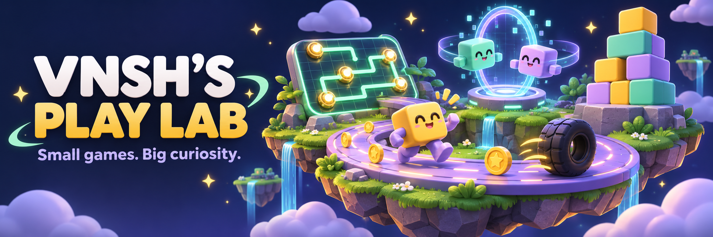

  

<h1 align="center">Hey, I'm Vnsh Kumar</h1>

<strong>Building playful experiences, one mechanic at a time.</strong>

Casual games · Interactive experiments · Augmented reality

  <a href="#level-select">Level select</a> ·
  <a href="https://github.com/kumarvnsh?tab=repositories">Explore the lab</a> ·
  <a href="https://github.com/kumarvnsh/Portfolio-VNSH">Portfolio source</a>

## Player one

Welcome to my Play Lab: a collection of games, prototypes, and interactive experiments. I enjoy turning ideas into experiences you can play, explore, and build on.

**The loop:** prototype → playtest → polish → play again.

## Level select

Four projects from the lab. Pick your next stop.

<table>
<tr>
<td width="50%" valign="top">

### 01 / Circuit Game

**The circuit corner**

A featured game project from my lab.

[View repository →](https://github.com/kumarvnsh/Circuit-Game)

Private source · repository access required

</td>
<td width="50%" valign="top">

### 02 / AR Multiplayer

**Beyond the screen**

A Unity project exploring multiplayer in augmented reality.

[View repository →](https://github.com/kumarvnsh/Ar_multiplayer)

Private source · repository access required

</td>
</tr>
<tr>
<td width="50%" valign="top">

### 03 / Tire Run 3D

**Keep it rolling**

An endless Android game.

[Explore the code →](https://github.com/kumarvnsh/Tire-Run-3D)

Public source · C#

</td>
<td width="50%" valign="top">

### 04 / StackUp

**One more level**

A stacking game project from my collection.

[Explore the code →](https://github.com/kumarvnsh/StackUp)

Public source · C#

</td>
</tr>
</table>

Banner art is a conceptual illustration of the lab, rather than gameplay screenshots.

## Developer's notebook

I’m interested in the small details that make an experience feel good: a clear interaction, a satisfying response, and a reason to try again.

- **Games:** experimenting with mechanics and playful interactions.
- **AR:** exploring experiences that extend beyond the screen.
- **Iteration:** making room to test, learn, and improve.

---

<strong>Small games. Big curiosity.</strong> Always another level.

