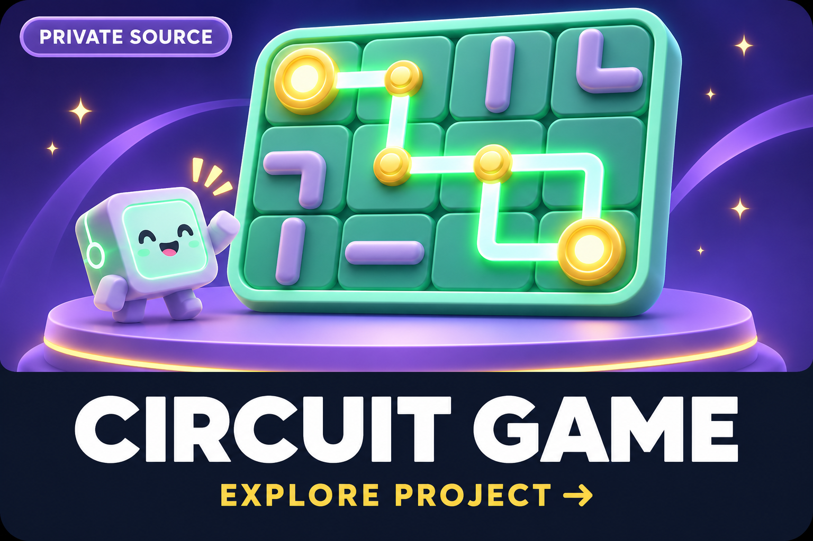
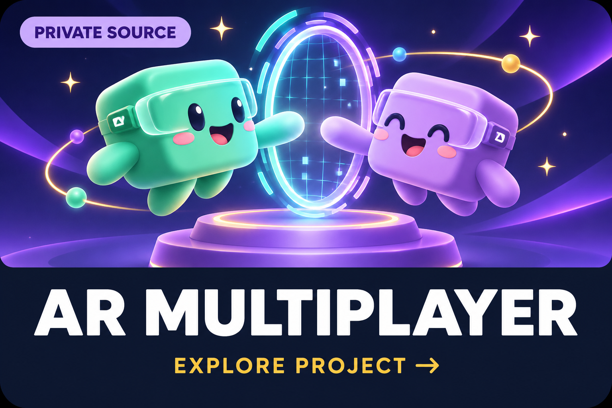
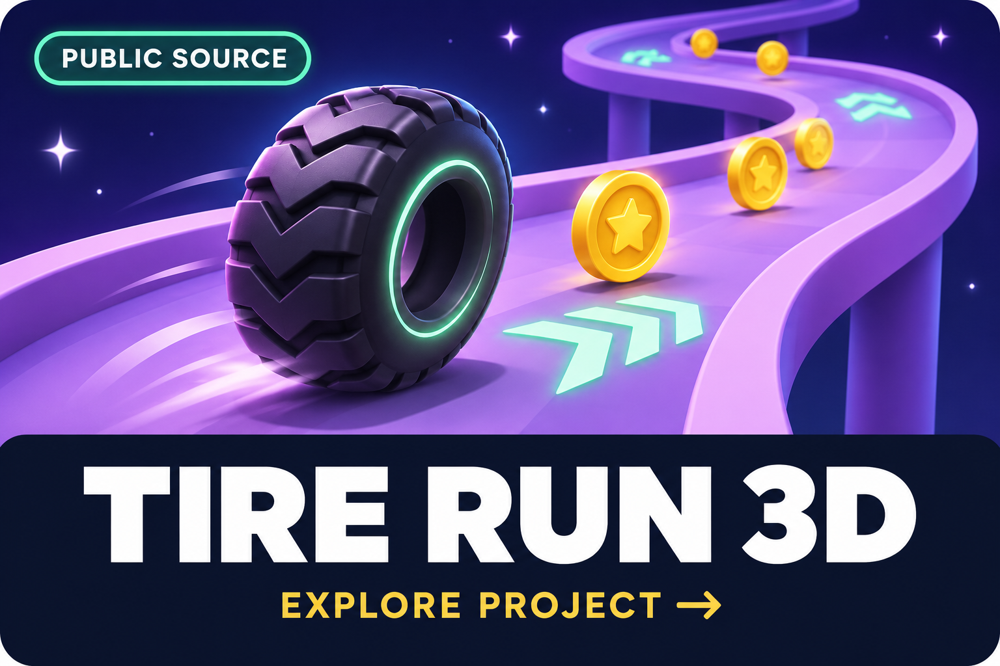
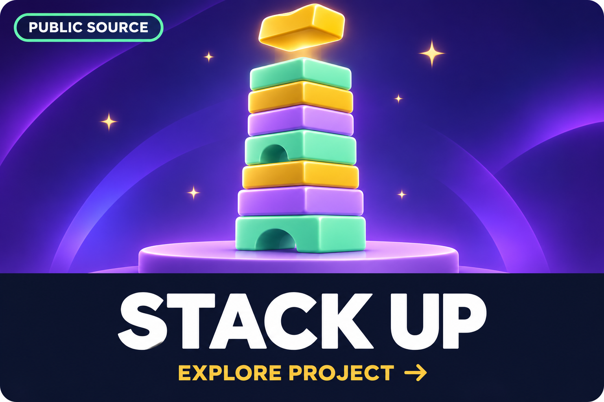
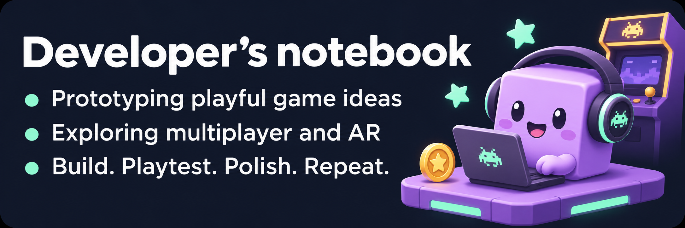

## Vnsh Kumar
**Games · Interactive experiments · AR**

I build games and explore interactive experiences—from casual mechanics to multiplayer and augmented reality.

### Level select

 

Circuit Game and AR Multiplayer require repository access. Artwork is illustrative.

  

<a href="https://github.com/kumarvnsh?tab=repositories">Explore the lab</a> ·
<a href="https://github.com/kumarvnsh/Portfolio-VNSH">Portfolio source</a>

